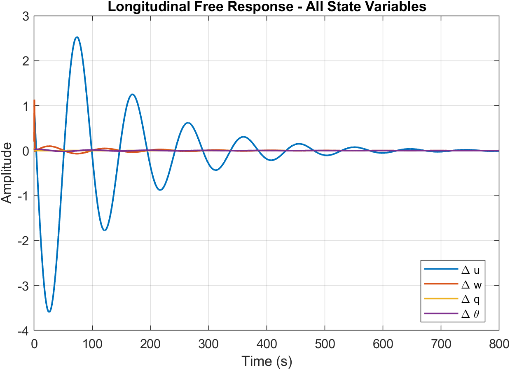
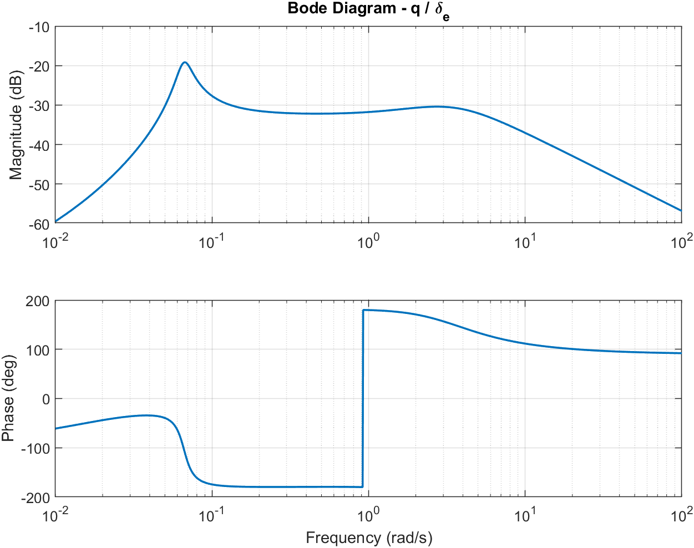
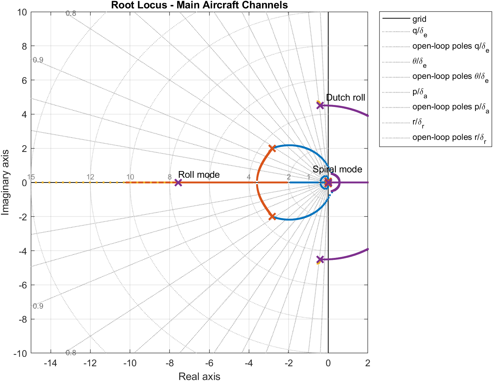
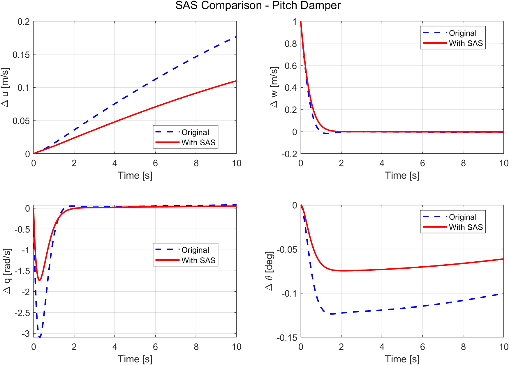
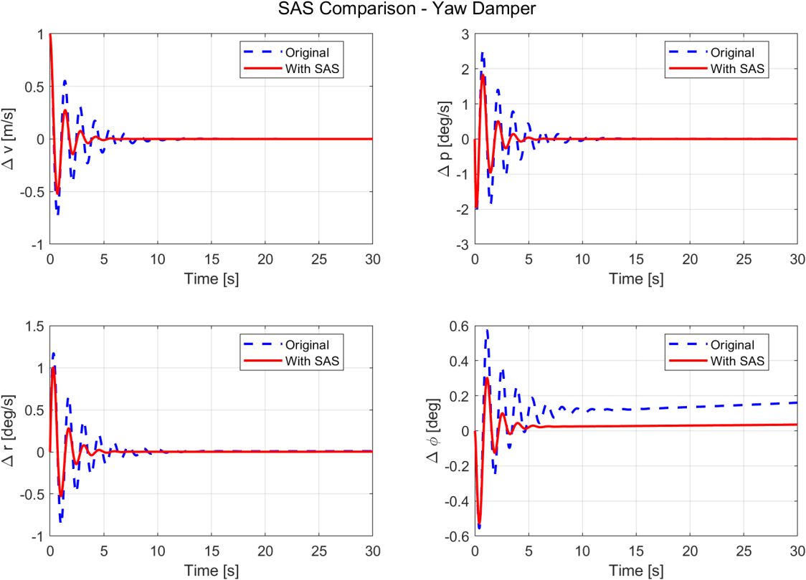

# C2 Aircraft — Flying & Handling Qualities Analysis (MATLAB)

End-to-end dynamic stability and flying qualities analysis of the **C2 aircraft** (Class I), assessed against the **MIL-F-8785C** military specification, entirely in MATLAB: linearized state-space models, eigenvalue analysis of the five stability modes, time and frequency responses, and the design of a pitch damper and a yaw damper by pole placement.

*IPSA Paris, Aéro 4PA2 — Flight Mechanics homework, April 2026 (report written in English).*

## Overview

The work follows the standard flight-mechanics pipeline:

1. Linearize the equations of motion about a steady level-flight condition (small perturbations)
2. Build the longitudinal and lateral state-space models (4×4 each) from the aircraft's aerodynamic and inertial data
3. Extract the stability modes by eigenvalue / eigenvector decomposition
4. Simulate free responses and compute control transfer functions (Bode diagrams, root locus)
5. Check each mode against the MIL-F-8785C Level 1/2/3 requirements
6. Design stability augmentation systems (SAS) by pole placement and verify them in the time domain

## Aircraft and flight condition

| Parameter | Value | Parameter | Value |
|---|---|---|---|
| Wing area S | 12.63 m² | Altitude | 7620 m |
| Mean aerodynamic chord c̄ | 1.65 m | Mach number | 0.6 |
| Wingspan b | 8.02 m | Airspeed U₀ | 185.9 m/s |
| Aspect ratio | 5.09 | Dynamic pressure q̄ | 9500 Pa |
| Oswald factor e | 0.94 | Air density ρ | 0.55 kg/m³ |
| C_L0 / C_D0 | 0.15 / 0.022 | Flight path angle Θ₀ | 0° |

Mass 1816 kg · I_xx = 1085 · I_yy = 6511 · I_zz = 7053 · I_xz = 271 (kg·m²).

**Inertial coupling:** I_xz/I_xx = 0.25 is not negligible, so the roll–yaw coupling is kept by pre-multiplying the lateral model with the inverse of the inertia matrix Iₙ. This visibly changes the yaw-row derivatives (for example N_p changes sign, from +0.265 to −0.022).

## Stability modes

Eigenvalues of the 4×4 longitudinal and lateral state matrices:

| Mode | Eigenvalue(s) | ωₙ (rad/s) | ξ | Period / time constant |
|---|---|---|---|---|
| Short period | −2.8237 ± 2.0036j | 3.462 | 0.816 | 3.14 s period, t½ = 0.25 s |
| Phugoid | −0.0074 ± 0.0658j | 0.0662 | 0.111 | 95.5 s period, t½ = 94 s |
| Dutch roll | −0.4169 ± 4.5040j | 4.523 | 0.092 | 1.40 s period |
| Roll | −7.5700 | — | — | T = 0.132 s |
| Spiral | +0.0171 (unstable) | — | — | T₂ = 40.6 s (time to double) |

The exact 4×4 results were also compared with the classical 2×2 approximations. Short period, roll and Dutch roll match within a few percent. The phugoid approximation overestimates the natural frequency by about 28% (constant-angle-of-attack assumption), and the spiral approximation is far from the exact eigenvalue, since that mode depends on a delicate balance between several lateral derivatives.


*Longitudinal free response (ode45, mixed initial conditions) — the fast short-period transient dies out within ~5 s, then the lightly damped phugoid dominates in Δu for several hundred seconds*

## Frequency-domain analysis

Control transfer functions are computed from the state-space matrices as X(s)/η(s) = (sI − A)⁻¹B, and the Bode diagrams are obtained by evaluating this expression numerically at s = jω over a logarithmic frequency range.


*Bode diagram of pitch rate response to elevator (q/δe) — two resonance peaks, at the phugoid (~0.07 rad/s) and short-period (~3.5 rad/s) frequencies*


*Root locus of the four main transfer functions (q/δe, θ/δe, p/δa, r/δr) with s-plane grid — roll mode far left on the real axis, Dutch roll pair near −0.4 ± 4.5j, and the slightly unstable spiral mode just right of the imaginary axis*

## Flying qualities assessment (MIL-F-8785C, Class I, Category B)

| Mode | Parameter | Value | Level 1 requirement | Level |
|---|---|---|---|---|
| Short period | ξ / CAP | 0.816 / 0.324 | 0.30–2.00 / 0.085–3.6 | **1** |
| Phugoid | ξ | 0.111 | ≥ 0.04 | **1** |
| Roll | T_roll | 0.132 s | ≤ 1.4 s | **1** |
| Spiral | T₂ | 40.6 s | ≥ 20 s | **1** |
| Dutch roll | ξ / ξωₙ / ωₙ | 0.092 / 0.417 / 4.52 | ≥ 0.08 / ≥ 0.15 / ≥ 0.5 | **1** |

CAP is computed from n/α = q̄·S·C_Lα/(m·g) = 37.04 g/rad and CAP = ωₙ_SP² / (n/α) = 0.324.

**All five modes satisfy Level 1**, so the aircraft needs no mandatory SAS. The short-period and Dutch roll damping margins are however modest, which motivates the augmentation design below.

## Stability augmentation system (pole placement)

Both loops use full-state feedback gains computed by pole placement (A* = A − B·Kᵀ), after checking that the controllability matrix has full rank 4 from the elevator (longitudinal) and rudder (lateral) inputs.

| | Pitch damper | Yaw damper |
|---|---|---|
| Target | ξ_SP: 0.816 → 0.95 | ξ_DR: 0.092 → 0.20 |
| New poles | −3.2892 ± 1.0811j | −0.9047 ± 4.4319j |
| Gain vector K | [0.0048, 0.0682, −6.4794, 0.0093] | [−0.0110, 0.0859, −12.022, 0.6319] |
| Dominant term | pitch-rate feedback (−6.48) | yaw-rate feedback (−12.02) |
| Preserved | ωₙ_SP and phugoid poles | ωₙ_DR, roll and spiral poles |

**Pitch damper:** for a unit perturbation in Δw, the peak pitch rate drops from −3 to −1.8 rad/s (−40%) and the peak pitch attitude from −0.125° to −0.075°.


*Pitch damper — original (blue dashed) vs augmented (red solid) response to a unit Δw perturbation. The phugoid drift in Δu is intentionally left unchanged.*

**Yaw damper:** the Dutch roll oscillation, which persisted for about 15 s, is essentially damped within 5 s, and the product ξ·ωₙ rises from 0.417 to 0.905 (+117%). The spiral divergence is intentionally left unchanged.


*Yaw damper — original (blue dashed) vs augmented (red solid) response to a unit sideslip perturbation*

## Key takeaways

- The roll–yaw inertial coupling (I_xz/I_xx = 0.25) cannot be neglected: it changes the lateral derivatives enough to alter the lateral dynamics.
- A mode can satisfy Level 1 and still have thin margins. The pitch and yaw dampers were designed to widen them (ξ_SP 0.82 → 0.95, ξ_DR 0.09 → 0.20) without touching the other modes.
- The classical 2×2 approximations are reliable for the short period, roll and Dutch roll, but not for the phugoid and spiral, where the exact 4×4 eigenvalues are needed.

## Repository content

```
C2-Flying-Qualities-MATLAB/
├── README.md
├── code/
│   └── C2_flying_qualities.m     # full MATLAB script (data, matrices, modes, responses, MIL assessment, SAS)
├── images/                        # figures used in this README
└── report/
    └── Homework_Report_C2.pdf     # full report (theory, derivations, results)
```

Running the script reproduces the full analysis and exports the report figures to a `report_figures/` folder. The pole placement step uses `place` (Control System Toolbox).

## Tools

`MATLAB` — `eig`, `ode45`, `place`, state-space modeling, numerical frequency response

---
*Academic project — IPSA Paris, Aéro 4PA2, April 2026.*
